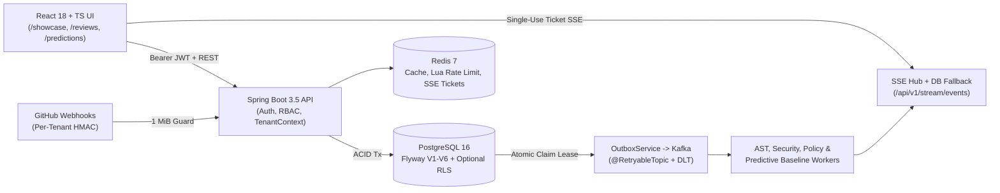

# FORGE — Predictive Software Engineering & Change Impact Intelligence Platform

> **"Understand the impact of every code change. Predict what could fail before it reaches production."**
>
> Built with Java 21 LTS, Spring Boot 3.5.16, PostgreSQL 16 (Flyway V1–V6), Apache Kafka, Redis, JavaParser AST, Resilience4j, Spring AI, ArchUnit, OpenTelemetry, and React 18 + TypeScript + Monaco + React Flow.
>
> **Public Technical Showcase:** `/showcase` (no login required — interactive architecture diagram, clearly labelled simulated PR walkthrough, engineering trade-offs, direct GitHub source map, interview Q&A, and explicit limitations; zero private tenant data exposed).

---

## System Architecture



## Core Architecture Principle

**Deterministic code analysis, dependency intelligence, and Policy-as-Code own merge risk decisions (`PASS` / `WARN` / `BLOCK`).** AI explains, summarizes, and enriches evidence — it never independently invents merge blocks or bypasses deterministic policy gates.

> **Important Safety Note:** A `PASS` merge decision means no configured blocking policy condition was triggered by static/deterministic analysis. It is **not** a guarantee of runtime correctness or production safety, and FORGE never claims that unexecuted recommended tests have passed.

---

## Verified Engineering Capabilities

1. **Deterministic Change Impact & Risk Engine (`review`, `codeintel`)**
   - Full analysis pipeline: `PR Diff -> Changed Files & Symbols -> AST / Dependency Graph -> Impacted Modules & Cycles -> API Compatibility -> DB Migration Compatibility -> Test Selection -> Security Scan -> Policy-as-Code Risk Score -> Explainable PASS / WARN / BLOCK`.
   - Every risk score includes weighted contributing factors, severity, confidence, file/line evidence, explanation, and the exact policy rule that triggered the decision.
   - Workspace-configurable **Change Risk Policy-as-Code** (`GET / PUT /api/v1/policies`) supporting thresholds, critical security / breaking API / destructive migration / prompt-injection gates, sensitive paths, and architecture layer boundaries.
2. **Code Intelligence & Architecture Drift (`codeintel`)**
   - **Java 21 AST analysis** via `JavaParser` (classes, interfaces, enums, records, constructors, nested types, overloaded method signatures, cyclomatic complexity, AST-level call/type references).
   - **TypeScript / JavaScript structural analysis** via lexical comment/string stripping + ES/CJS import/export and symbol extraction.
   - Disambiguated dependency graphs, DFS circular dependency detection, BFS downstream blast-radius impact chains, and layer-rule **Architecture Drift** reporting (`GET /api/v1/repositories/{id}/code-intel/drift`).
3. **API & Database Migration Compatibility (`review`)**
   - **API Compatibility (`ApiCompatibilityAnalyzer`)**: Diffs OpenAPI YAML/JSON specs and Spring MVC `@RequestMapping` / DTO signatures for removed endpoints, changed routes, removed required fields, and breaking schema changes.
   - **Migration Compatibility (`MigrationCompatibilityAnalyzer`)**: Flags Flyway history tampering, destructive DDL (`DROP TABLE`, `DROP COLUMN`, `TRUNCATE`, `ALTER COLUMN TYPE`, `NOT NULL` without default), and recommends expand-and-contract patterns.
4. **Intelligent Test Selection (`review`)**
   - Selects unit/integration tests directly matching changed files, AST-linked dependents, and historical CI failure patterns with explicit selection reasons and runnable Maven/Vitest commands.
   - All selected tests are explicitly labeled **`NOT_EXECUTED`** unless executed externally in CI.
5. **Security Intelligence, SCA, SBOM & SARIF (`security`)**
   - **Secret Scanner**: High-precision signatures (AWS, GitHub, Stripe, OpenAI, GCP, Slack, DB URIs, PEM blocks with full private-key redaction, multi-match line masking) plus **Shannon entropy detection** (`SECRET-ENTROPY-007`) with UUID/SHA/placeholder allowlists.
   - **SAST & IaC Rules**: SQLi, SSRF, Path Traversal, Weak Crypto, Unsafe Deserialization, XSS, Prompt Injection (`FORGE-PROMPT-001`), plus `Dockerfile`, Kubernetes YAML, and GitHub Actions workflow checks.
   - **SCA & Export Standards**: Maven (`pom.xml`) and npm (`package.json`) dependency extraction against an offline deterministic CVE catalog, **CycloneDX 1.5 JSON SBOM** export (`GET /api/v1/security/repositories/{id}/sbom`), **OASIS SARIF 2.1.0** export (`GET /api/v1/security/repositories/{id}/sarif`), and persistent **Finding Suppressions** (`GET / POST / DELETE /api/v1/security/suppressions`).
6. **Hardened Multi-Tenant Security & Identity (`identity`, `common`, `sse`)**
   - Strict profile separation (`local`, `demo`, `test`, `prod`) with zero localhost infrastructure fallbacks in `application-prod.yml` and fail-fast **`ProductionSecurityValidator`** enforcing strong JWT/AES/DB/Redis secrets, non-localhost DB/Redis/Kafka hosts, non-wildcard CORS, and disabled demo seeding in production.
   - HS256 JWT access tokens (`jti`, `iss`, `aud`, `ver`) + **concurrency-safe rotating refresh tokens** (`PESSIMISTIC_WRITE` + atomic `revokeIfActive`, reuse-detection family revocation), JTI logout revocation, HTTP security response headers, and brute-force account lockout (`HTTP 423`).
   - **Single-use SSE tickets** (`POST /api/v1/stream/ticket` -> `GET /api/v1/stream/events?ticket=...`) with fail-closed Redis ticket redemption — JWTs are never accepted in query parameters.
   - Versioned **AES-256-GCM encryption** (`v1:<kid>:<base64>`) with tenant/purpose AAD binding and zero-downtime key rotation (`FORGE_ENCRYPTION_PREVIOUS_KEYS`).
   - Per-tenant CSPRNG GitHub webhook secrets (`POST /api/v1/settings/rotate-webhook-secret`), 1 MiB payload size guard (`HTTP 413`), constant-time HMAC-SHA256 verification, payload + delivery replay protection, and optional PostgreSQL 16 Row-Level Security ([docs/postgres-rls.sql](docs/postgres-rls.sql)).
7. **Predictive Engineering Intelligence Engine (`prediction`)**
   - **Deterministic Failure Baselines:** Explainable pre-merge forecasts for **Bug/Defect Risk**, **Test Failure Risk** (predicted tests strictly separated from actual CI test executions), **Production Incident Risk** (correlational evidence only — never claims unverified causation), **Deployment Change Failure & Rollback Risk** (tracking failed deployments, rollbacks, incidents, and defects separately), and **Static Performance Regression Warnings** (N+1 DB queries, nested loops, unbounded reads, broad cache invalidations, sync I/O in loops).
   - **7-Channel Deduplicated Risk Aggregation:** Keeps static code analysis, dependency impact, security, predicted defect, predicted test failure, predicted operational risk, and static performance warnings separate without double-counting shared evidence. Predictions are advisory and **never** automatically block a PR.
   - **Real Historical Engineering Data & Anti-Leakage Held-Out Evaluation:** Idempotent ingestion APIs (`/api/v1/predictions/history/{tests|deployments|incidents|defects}`) with timestamp validation plus signed GitHub `workflow_run` & `deployment_status` webhooks. Chronological held-out evaluation (`POST /api/v1/predictions/evaluations/run`) uses the earliest pre-outcome prediction run per PR, excludes pre-prediction outcomes to prevent temporal leakage, reports `null` for undefined class-imbalance ratios, and returns `INSUFFICIENT_LABELLED_DATA` until at least 5 real matched outcomes exist.
8. **Real-Time Pipeline Timeline, Distributed Reliability & Observability (`sse`, `messaging`, `ci`, `analytics`)**
   - **Live Processing Timeline (`LiveProcessingPanel`)**: Dark-first connected vertical stage timeline rendering genuine backend stage transitions (`PR_REVIEW`, `PR_PREDICTION`, `REPO_INDEX`), monotonic sequence deduplication, wall-clock elapsed duration, expandable diagnostics, error retry, and automatic browser-refresh recovery via `GET /api/v1/stream/operations`. Zero fake progress timers or fabricated percentages.
   - Atomic multi-replica **Transactional Outbox** (`tryClaimEvent` conditional claim + worker leases + dead-letter requeue), two-phase JDBC idempotency, Apache Kafka `@RetryableTopic` + `ORIGINAL_TOPIC` DLT routing, resilient Redis caching & atomic Lua rate limiting, and Resilience4j circuit breakers on GitHub & LLM calls.
   - End-to-end `X-Correlation-Id` propagation (HTTP -> MDC -> Outbox -> Kafka -> SSE), native structured JSON logging in `prod`, Kubernetes liveness/readiness health probes (`/actuator/health/liveness`, `/actuator/health/readiness`), and Prometheus metrics (`forge.reviews.*`, `forge.predictions.*`, `forge.outbox.*`, `forge.kafka.dlt.events`, `forge.webhooks.processed`, `forge.sse.*`, `forge.redis.errors`).

---

## Supported Languages & Known Analysis Limitations

| Area | Current Implementation | Known Limitations |
|---|---|---|
| **Java** | Full Java 21 AST via `JavaParser` (types, enums, records, methods, overloaded signatures, complexity, AST references) | Cross-module classpath / external JAR bytecode symbol resolution is not performed; analysis operates on indexed source files. |
| **TypeScript / JavaScript** | Lexical comment/string stripper + structural ES/CJS import, class, interface, type, enum, and function extractor | Not a full `tsc` type-checker; dynamic `require()` expressions and deep generic type inference are not resolved. |
| **API Compatibility** | OpenAPI 3 YAML/JSON diffing + Spring MVC annotation & DTO inspection | GraphQL, gRPC/Protobuf, and non-Spring server frameworks are not yet supported. |
| **Database Migrations** | SQL / Flyway migration static AST/pattern inspection | Does not execute migrations against a live shadow database or evaluate runtime lock contention for table sizes. |
| **SCA & SBOM** | Parses `pom.xml` and `package.json`, produces CycloneDX 1.5 JSON, checks a curated deterministic offline CVE catalog | Does not resolve transitive lockfiles (`package-lock.json` / Maven BOMs) or query live OSV/NVD APIs at runtime. |
| **Test Selection** | Static file/AST dependency mapping + historical CI failure correlation | FORGE never executes untrusted repository code on its API server; selected tests are strictly marked `NOT_EXECUTED`. |
| **Predictive Failure Intelligence** | Deterministic rule/baseline predictors (`DETERMINISTIC_BASELINE_V1`) over diff, AST, blast radius & real persisted historical outcomes; chronological held-out evaluation | No trained ML model yet (ML is deferred until sufficient calibrated, real labelled historical outcomes exist); uncalibrated probabilities are intentionally omitted (`null`). |
| **Performance Regression Detection** | Static diff analyzer for N+1 queries, nested loops, expensive/unindexed SQL, unbounded memory loads, sync external calls, and cache clears | No live APM / benchmark telemetry connected; findings are explicitly labeled static performance warnings rather than measured latency regressions. |
| **AI Review Enrichment** | Spring AI OpenAI (when `OPENAI_API_KEY` is configured & provider is `HYBRID`/`OPENAI`) with `SystemMessage`/`UserMessage` separation and prompt-injection quarantine | Falls back cleanly to deterministic analysis (`DETERMINISTIC` mode or when no API key is configured). |

---

## Quick Start

### Option 1 — Clean Local Development (Zero Docker Needed)
Requires **Java 21 LTS** and **Node.js 22+**.

```powershell
# 1. Start Backend (clean local H2 PostgreSQL-mode database, no pre-seeded demo credentials)
cd backend
.\mvnw.cmd spring-boot:run
```
- API: `http://localhost:8080/api/v1`
- OpenAPI / Swagger UI: `http://localhost:8080/swagger-ui.html`
- Prometheus Metrics: `http://localhost:8080/actuator/prometheus`

```powershell
# 2. Start Frontend
cd frontend
npm ci
npm run dev
```
- UI: `http://localhost:5173` — Create a new workspace via the **Register** tab on `/login`.

### Option 2 — Isolated Demo Mode (Explicit Opt-In Only)
Demo seeding is **disabled by default** and strictly blocked when the `prod` profile is active. To seed a sample local workspace for demonstrations, explicitly enable the `demo` profile and provide an operator-chosen password:

```powershell
cd backend
$env:SPRING_PROFILES_ACTIVE = "local,demo"
$env:FORGE_SEED_ENABLED = "true"
$env:FORGE_DEMO_PASSWORD = "<choose-a-strong-local-password>"
.\mvnw.cmd spring-boot:run
```

### Option 3 — Production-Like Stack (Docker Compose)
Copy [`.env.example`](.env.example) to `.env`, populate strong secrets (`FORGE_JWT_SECRET`, `FORGE_ENCRYPTION_KEY`, `POSTGRES_PASSWORD`, `REDIS_PASSWORD`, `GRAFANA_ADMIN_PASSWORD`), and run:

```bash
cp .env.example .env
docker compose --env-file .env up --build
```
All stateful containers bind exclusively to `127.0.0.1`. See [docs/RUNBOOK.md](docs/RUNBOOK.md) for PostgreSQL RLS activation and secret rotation.

---

## Environment Variables Reference

| Variable | Profile | Required | Purpose |
|---|---|---|---|
| `SPRING_PROFILES_ACTIVE` | All | Optional (`local` default) | `local`, `local,demo`, or `prod` (`demo` is blocked when `prod` is active) |
| `SPRING_DATASOURCE_URL` / `USERNAME` / `PASSWORD` | `prod` | Yes (`prod`) | PostgreSQL 16 JDBC connection (non-localhost, non-H2 enforced by `ProductionSecurityValidator`) |
| `SPRING_DATA_REDIS_HOST` / `PORT` / `PASSWORD` | `prod` | Yes (`prod`) | Redis 7 connection for resilient cache, Lua rate limiting & fail-closed SSE tickets |
| `SPRING_KAFKA_BOOTSTRAP_SERVERS` | `prod` | Yes (`prod`) | Kafka broker address for Outbox topics (`forge.pr-review.requested`, `forge.pr-prediction.requested`, `forge.repo-index.requested`) |
| `FORGE_JWT_SECRET` | `prod` | Yes (`prod`) | Minimum 32-byte random HS256 JWT signing secret |
| `FORGE_ENCRYPTION_KEY` / `FORGE_ENCRYPTION_KEY_ID` | `prod` | Yes (`prod`) | Base64 32-byte AES-256-GCM key & active key ID (default `k1`) |
| `FORGE_ENCRYPTION_PREVIOUS_KEYS` | `prod` | Optional | Comma-separated `kid:key` pairs for zero-downtime key rotation |
| `FORGE_CORS_ORIGINS` | `prod` | Yes (`prod`) | Explicit comma-separated frontend origin(s); wildcard `*` is rejected |
| `FORGE_OPENAI_API_KEY` / `FORGE_AI_PROVIDER` | All | Optional | Enables optional LLM review enrichment (`HYBRID`); runs deterministically when omitted |
| `FORGE_SWAGGER_ENABLED` | `prod` | Optional (`false`) | Explicitly opt in to OpenAPI/Swagger UI in production |

---

## API Surface Summary

OpenAPI / Swagger UI is served at `/swagger-ui.html` in `local` mode (disabled by default in `prod`).

| Domain | Key Endpoints | Auth / Role |
|---|---|---|
| **Auth & Session** | `POST /api/v1/auth/register`, `/login`, `/refresh`, `/logout`, `GET /api/v1/auth/me` | Public for login/register/refresh; Bearer JWT for `/me` & `/logout` |
| **Repositories & AST** | `GET/POST /api/v1/repositories`, `POST /api/v1/repositories/{id}/reindex`, `GET /api/v1/repositories/{id}/code-intel/{graph,impact,drift}` | Bearer JWT (`OWNER`/`ADMIN`/`REVIEWER` for writes) |
| **PR Reviews & Policy** | `GET/POST /api/v1/reviews`, `POST /api/v1/reviews/import-github`, `GET/PUT /api/v1/policies` | Bearer JWT (`OWNER`/`ADMIN` for policy updates) |
| **Predictive Engine** | `GET /api/v1/predictions/overview`, `GET /api/v1/predictions/{pullRequestId}`, `POST /api/v1/predictions/{pullRequestId}/run`, `POST /api/v1/predictions/history/{tests,deployments,incidents,defects}`, `POST /api/v1/predictions/evaluations/run` | Bearer JWT (`OWNER`/`ADMIN`/`REVIEWER` for ingestion/eval) |
| **Security & Exports** | `GET /api/v1/security/findings`, `GET /api/v1/security/repositories/{id}/{sbom,sarif}`, `GET/POST/DELETE /api/v1/security/suppressions` | Bearer JWT (`OWNER`/`ADMIN` for suppressions) |
| **Real-Time SSE** | `POST /api/v1/stream/ticket`, `GET /api/v1/stream/events?ticket=...`, `GET /api/v1/stream/operations` | Bearer JWT for ticket & snapshots; single-use ticket for SSE stream |
| **Health & Telemetry** | `GET /actuator/health`, `/actuator/health/liveness`, `/actuator/health/readiness`, `/actuator/prometheus` | Probes public; `/actuator/prometheus` requires `OWNER`/`ADMIN` |

---

## Recruiter & Interviewer 2-Minute Demo Walkthrough

1. Start the backend (`cd backend && ./mvnw spring-boot:run`) and frontend (`cd frontend && npm ci && npm run dev`).
2. Open **`http://localhost:5173/showcase`** (public — no sign-in required) to inspect the interactive architecture diagram, clearly labelled simulated PR walkthrough, engineering trade-offs, source map, interview Q&A, and limitations.
3. Click **Sign In / Register**, create a fresh isolated workspace on `/login`, connect a starter repository on `/repositories`, and submit a PR diff on `/reviews?new=1` to watch genuine backend SSE stages stream live, inspect the deterministic `PASS`/`WARN`/`BLOCK` verdict, and review explainable predictive evidence on `/predictions`.

---

## Verification & Automated Tests

```powershell
# Backend (JUnit 5 + Security + Multi-Tenant Isolation + Change Risk + ArchUnit)
cd backend
.\mvnw.cmd test

# PostgreSQL 16 Flyway V1-V6 Testcontainers Suite (requires Docker daemon; runs automatically in GitHub Actions CI)
.\mvnw.cmd test -Dtest=PostgresMigrationContainersIT

# Frontend (Production Dependency Audit + Strict TypeScript + Vitest + Production Bundle)
cd frontend
npm audit --omit=dev --audit-level=high
npm run typecheck
npm run test
npm run build
```

---

## Documentation
- [System Architecture & Kafka Catalogue](docs/ARCHITECTURE.md)
- [Security Threat Model & Hardening Controls](docs/SECURITY.md)
- [Operational Runbook & Secret Rotation](docs/RUNBOOK.md)
- [PostgreSQL 16 Row-Level Security Script](docs/postgres-rls.sql)
- [Product Requirements Document](docs/PRD.md)
- [Engineering Roadmap & Capability Status](docs/ROADMAP.md)
- [ADR-001: Modular Monolith & Outbox](docs/adr/ADR-001-modular-monolith.md)
