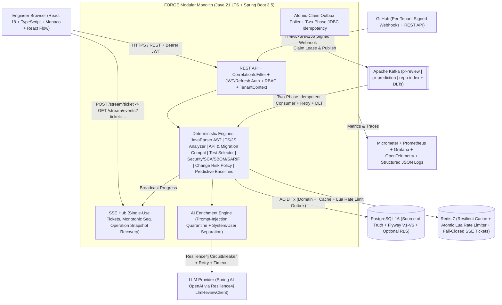

# FORGE System Architecture

## 1. High-Level Container Architecture (C4)



## 2. Deterministic Change Impact & Risk Pipeline

```mermaid
sequenceDiagram
    participant Client as Developer / GitHub Webhook
    participant API as Spring Boot API
    participant DB as PostgreSQL (Source of Truth)
    participant Outbox as Outbox Worker / Kafka
    participant Worker as ReviewPipelineService
    participant SSE as SSE Stream (Ticket-Auth)

    Client->>API: POST /api/v1/reviews (or Signed GitHub Webhook)
    API->>DB: Tx: Insert PR Review (QUEUED) + OutboxEvent + AuditLog
    API-->>Client: 202 Accepted (reviewId, status=QUEUED)
    Outbox->>DB: Atomic per-row conditional claim (tryClaimEvent + locked_until)
    Outbox->>Worker: Dispatch via Kafka (prod) or Virtual-Thread Local Bus (local) with X-Correlation-Id
    Worker->>DB: Two-Phase Idempotency Claim (processed_events IN_PROGRESS)
    Worker->>SSE: Stage 1/8: QUEUED (Operation accepted & queued)
    Worker->>SSE: Stage 2/8: INGESTING_DIFF (UnifiedDiffParser: ADDED/MODIFIED/DELETED/RENAMED + symbols)
    Worker->>SSE: Stage 3/8: AST_IMPACT_ANALYSIS (JavaParser + TS/JS graph, cycles, blast radius)
    Worker->>SSE: Stage 4/8: CONTRACT_AND_MIGRATION_ANALYSIS (OpenAPI/Spring diff + Flyway DDL check)
    Worker->>SSE: Stage 5/8: SECURITY_SCANNING (Secrets + Entropy + SAST + IaC + Offline SCA + Suppressions)
    Worker->>SSE: Stage 6/8: AI_CONTEXT_REVIEW (Prompt-Injection Quarantine + Contextual Findings)
    Worker->>SSE: Stage 7/8: RISK_AND_TEST_SELECTION (Deterministic Policy-as-Code PASS/WARN/BLOCK + Static Test Selection NOT_EXECUTED)
    Worker->>DB: Persist Risk Breakdown, Recommended Tests, Findings + Enqueue forge.pr-prediction.requested
    Worker->>SSE: Stage 8/8: COMPLETED (with structured summary details; recoverable via GET /api/v1/stream/operations)
```

## 2b. Real-Time SSE Processing Protocol & Recovery
- Every backend pipeline (`PR_REVIEW` 8 stages, `PR_PREDICTION` 5 stages, `REPO_INDEX` 4 stages) emits structured `PipelineEvent` records carrying `eventId`, `operationId`, `correlationId`, monotonic `sequence`, `stage`, `stageLabel`, `status` (`STARTED` | `IN_PROGRESS` | `COMPLETED` | `FAILED`), `stageIndex`, `totalStages`, factual `message`, structured `details`, and `timestamp`.
- `SseHubService` records every stage into a bounded per-tenant `OperationStatusSnapshot` ring buffer even when zero browser clients are attached.
- On initial mount, browser refresh, or SSE reconnect, the frontend subscribes to `/api/v1/stream/events?ticket=...` and hydrates `/api/v1/stream/operations` so no stage transition is lost. Client state merges strictly by `eventId` deduplication and monotonic `sequence`, preventing duplicate rows, out-of-order regressions, or terminal state re-opening. Zero synthetic timers or fabricated percentages are used.

## 3. Database Schema Overview (Flyway V1–V6)
- **V1 (`V1__initial_schema.sql`)**: Core tables `tenants`, `users`, `repositories`, `source_files`, `code_symbols`, `code_dependencies`, `pull_request_reviews`, `review_findings`, `security_findings`, `ci_builds`, `audit_logs`, `evaluation_runs`, `outbox_events`, `processed_events`.
- **V2–V3**: Indexes and schema extensions for evaluation/CI metrics.
- **V4 (`V4__security_and_reliability_hardening.sql`)**:
  - `users`: `failed_login_attempts`, `locked_until`, `token_version`.
  - `refresh_tokens`: Rotating refresh token hashes, `family_id`, `replaced_by_token_id`, `revoked_at`, `expires_at`.
  - `outbox_events`: Worker lease columns (`locked_by`, `locked_until`).
  - `processed_events`: Two-phase idempotency status (`IN_PROGRESS` / `COMPLETED`) and lease metadata.
  - `pull_request_reviews`: `publish_status` (`NOT_PUBLISHED`, `PUBLISHED`, `PUBLISH_FAILED`).
  - Composite `(tenant_id, id)` unique constraints on core tenant-owned tables.
- **V5 (`V5__change_risk_policy_and_suppressions.sql`)**:
  - `pull_request_reviews`: `merge_decision` (`PASS`/`WARN`/`BLOCK`), `risk_breakdown_json`, `recommended_tests_json`.
  - `security_findings`: deterministic `fingerprint` column for suppression matching.
  - `finding_suppressions`: Persistent rule/file/fingerprint suppressions with `reason`, `expires_at`, and `created_by`.
  - `change_risk_policies`: Workspace/repository Policy-as-Code rules (`block_on_critical_security`, `block_on_breaking_api`, `block_on_destructive_migration`, `block_on_prompt_injection`, score thresholds, `sensitive_paths_json`, `architecture_rules_json`, `version`).
- **V6 (`V6__predictive_engineering_intelligence.sql`)**:
  - Historical engineering store (all tenant-scoped with composite `(tenant_id, id)` keys and idempotent `external_event_key` indexes): `engineering_events`, `historical_test_executions`, `deployment_records`, `incident_records`, `defect_records`.
  - Predictive baseline & evaluation store: `prediction_runs` (7-channel deduplicated breakdown + feature snapshot), `prediction_items` (nullable `probability` omitted unless calibrated, `confidence_level`, `insufficient_data`, `limitations`, `recommended_action`), `prediction_evidence`, `prediction_model_evaluations` (chronological held-out evaluation metrics).

## 4. Kafka Event Catalogue
| Topic | Producer | Consumer | Key | Retry / DLT Policy |
|---|---|---|---|---|
| `forge.pr-review.requested` | `OutboxService` | `KafkaDomainEventListener` (`ReviewPipelineService`) | `tenantId:reviewId` | 3 attempts exponential backoff -> `forge.pr-review.requested.dlt` |
| `forge.pr-prediction.requested` | `OutboxService` | `KafkaDomainEventListener` (`PredictionPipelineService`) | `tenantId:reviewId` | 3 attempts exponential backoff -> `forge.pr-prediction.requested.dlt` |
| `forge.repo-index.requested` | `OutboxService` | `KafkaDomainEventListener` (`RepositoryService`) | `tenantId:repoId` | 3 attempts exponential backoff -> `forge.repo-index.requested.dlt` |
| `*.dlt` | Spring Kafka `@RetryableTopic` | `@DltHandler` (`ORIGINAL_TOPIC` inspection) | `tenantId:aggregateId` | Safe DLT audit logging with explicit `TenantContext` binding and cleanup |

## 5. Module Boundaries (Enforced by ArchUnit)
- `common` depends on NO other `com.forge.platform.*` package.
- `audit` depends only on `common` and `identity`.
- `codeintel` must NOT depend on `review`, `prediction`, `ci`, or `analytics` (enforced by `ArchitectureBoundaryTest`).
- `review` triggers predictions asynchronously via `OutboxService` (`ForgeTopics.PR_PREDICTION_REQUESTED`) with zero direct dependency on `prediction`.
- Unscoped `SourceFileJpaRepository.findById` is prohibited by ArchUnit rule.
- Frontend uses route-level `React.lazy` code splitting (initial entry bundle ~323 kB gzipped ~103 kB; `PredictiveIntelligencePage` 32.4 kB gzipped 7.7 kB), strict TypeScript (`noUnusedLocals`, `noUnusedParameters`), single-flight JWT refresh retry, and strict session/cache teardown on logout or tenant switch.
