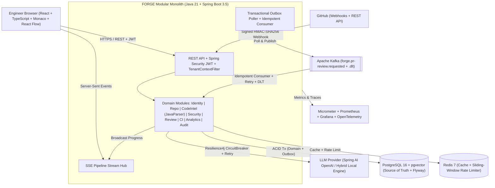
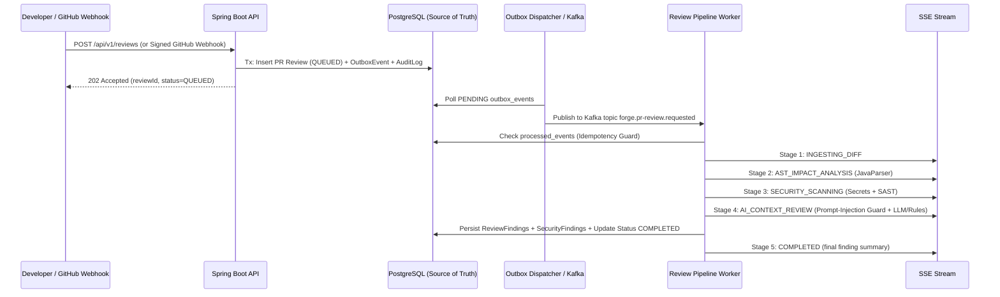

# FORGE System Architecture

## 1. High-Level Container Architecture (C4)

## 2. Event-Driven Pull Request Review Pipeline

## 3. Database ER Overview (Flyway Managed)
- `tenants` (1) -> (N) `users`, `repositories`, `pull_request_reviews`, `security_findings`, `ci_builds`, `audit_logs`, `evaluation_runs`
- `repositories` (1) -> (N) `source_files`, `code_symbols`, `code_dependencies`, `pull_request_reviews`, `security_findings`, `ci_builds`
- `pull_request_reviews` (1) -> (N) `review_findings`
- `outbox_events` (transactional event queue with `status`, `retry_count`, `next_attempt_at`, `error_message`)
- `processed_events` (idempotency deduplication table keyed on `event_key`)

## 4. Kafka Event Catalogue
| Topic | Producer | Consumer | Key | Retry / DLT Policy |
|-------|----------|----------|-----|--------------------|
| `forge.pr-review.requested` | `OutboxPublisher` | `PrReviewEventConsumer` | `tenantId:reviewId` | 3 attempts exponential backoff -> `forge.pr-review.dlt` |
| `forge.repo-index.requested` | `OutboxPublisher` | `RepoIndexEventConsumer` | `tenantId:repoId` | 3 attempts exponential backoff -> `forge.repo-index.dlt` |
| `forge.pr-review.dlt` | Kafka DLT Handler | Dead-Letter Audit / Alerting | `tenantId:reviewId` | Persisted to audit log & failed status |

## 5. Module Dependency Rules (Enforced by ArchUnit)
- `common` depends on NO other `com.forge.platform.*` module.
- Domain modules (`repository`, `codeintel`, `security`, `review`, `ci`, `analytics`) may depend on `common`, `identity`, `audit`, `messaging`, `sse`, and designated upstream domain services — never circularly.
- Controllers never access JPA repositories directly without going through a service layer for complex domain writes.
